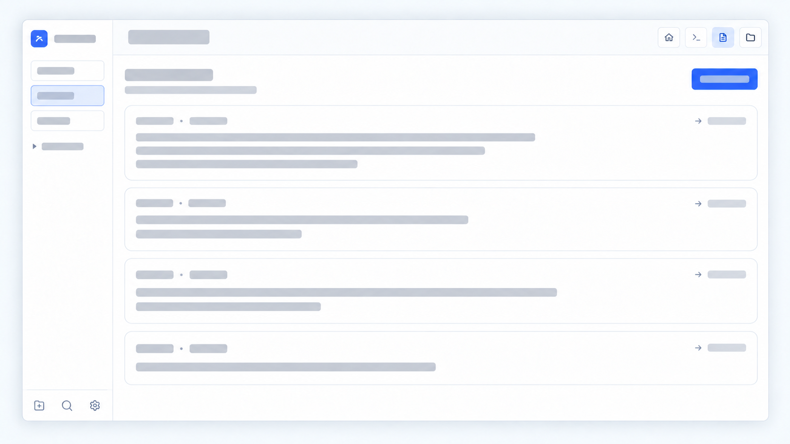
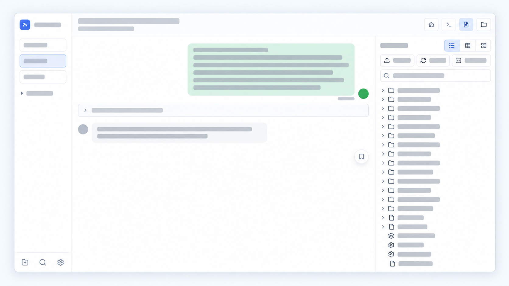
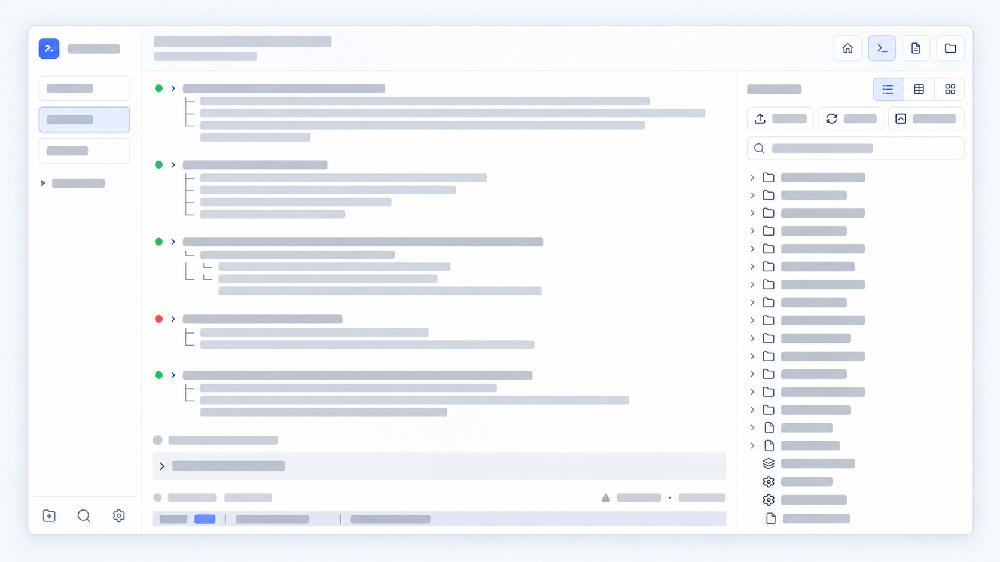

# AgentPorch

**Web chat for Codex and Pi. Terminals when you need them.**

Keep your coding agents on your own machine and bring their sessions to your browser. AgentPorch puts conversations, tool calls, project files, and terminals together so you can follow a task, inspect the result, and continue working from another device.

**Home — pending sessions**



| Rendered conversation | Terminal Tab |
| --- | --- |
|  |  |

*Illustrative views of the actual layouts. All text and project content is replaced with gray placeholders; no real session data is shown.*

## Chat first, terminal when needed

New and existing conversations open in web chat. Send messages, attach files or
paste images, and follow responses and tool results without opening a terminal.
Codex uses its shared app-server; Pi uses the native SDK runtime. Browser navigation
and disconnects do not send an abort command to either runtime.

The terminal is an independent, persistent tmux-backed project shell for advanced
work. Switching panes or directories never changes the conversation selected in
chat. Opening it does not launch a second agent for that conversation. Imported
Hermes and legacy Claude histories remain read-only in web chat.

## Why try it?

- **Choose your agent.** Start and resume Codex or Pi conversations, and browse imported Claude and Hermes history.
- **See the work happen.** Follow streaming responses and tool calls alongside your project files.
- **Keep your tools nearby.** Browse files, edit code, and open a terminal without leaving the session.
- **Pick up from another device.** Use a trusted HTTPS proxy or private tunnel to reach your workspace from a laptop or phone. HTTPS also enables the installable PWA.
- **Keep control of your environment.** AgentPorch runs where your repositories and agent tools live. You supply the agents and their credentials; AgentPorch is the interface.

Optional [SpecRelay](https://github.com/DeeliN221/specrelay) integration adds workflow monitoring and controls for starting, resuming, and stopping runs.

## Try it locally

**Requirements:** Node.js **24.17+ within Node 24**, or **26.4+ within Node 26**. Install and authenticate whichever agent you want to use. Missing agents do not prevent the web interface from starting.

```sh
npm install -g @deelin221/agentporch
agentporch
```

Open **http://127.0.0.1:3001** and enter the access token printed in your interactive terminal. Then choose a project and an available agent. Check **Settings → runtime diagnostics** if a tool is missing.

On first launch, AgentPorch creates its private state directory and a 32-character access token. When output is redirected, the token is not printed; read `AGENTPORCH_ACCESS_TOKEN` from `~/.agentporch/.env` instead.

Prefer to build from source? Follow the [development setup](docs/quickstart.md).

## What stays local?

Project access, terminal processes, configuration, and session storage live on the machine running AgentPorch. Your chosen agent may send prompts and code to its model provider under that provider's settings and policies.

The server binds to localhost by default. For remote use, explicitly configure the bind address and place the service behind a trusted HTTPS reverse proxy or private tunnel. Keep access-token authentication enabled: this workspace can read files and run commands.

## More than a chat window

| Workspace | Included |
| --- | --- |
| Agent sessions | Claude Code, Codex, Pi; session history and streaming tool activity |
| Project tools | File browser, editor, terminal, project overview |
| Diagrams | Mermaid and PlantUML previews rendered in the browser |
| Workflow tools | Optional SpecRelay workflow integration |
| Access | Self-hosted browser UI, responsive layouts, HTTPS PWA |

Diagram previews do not require Java, Graphviz, or an external rendering service. The optional `node-pty` dependency powers web terminals; the base web UI can still start without it.

## Local configuration

AgentPorch stores its configuration and application data in `~/.agentporch` by default. The database is `agentporch.db`; the browser token is `AGENTPORCH_ACCESS_TOKEN` in `.env`. Set `AGENTPORCH_HOME` to choose another private directory.

Project and session metadata lives under `${XDG_STATE_HOME:-~/.local/state}/agentporch`; uploads use `~/agentporch-uploads`. Browser settings, terminal sessions, and application-owned environment variables use the AgentPorch name as well.

This is a breaking rename. Stop an existing service and update its paths and environment variable names before restarting. Custom clients must use `agentporchSessionId` / `agentporch_session_id` in realtime messages. AgentPorch does not discover or migrate former installation names, browser settings, or persisted metadata automatically.

## Help and contributions

- [Quick start and deployment](docs/quickstart.md)
- [Troubleshooting](docs/troubleshooting.md)
- [Contributing](CONTRIBUTING.md)
- [Report a bug or suggest an improvement](https://github.com/DeeliN221/agentporch/issues)

If you try AgentPorch, tell us which agent and operating system you use, what worked, and where you got stuck. Remove tokens and private project content from reports.

## Credits and license

AgentPorch evolved from [claudecodeui](https://github.com/siteboon/claudecodeui). It is an independent project and is not an official product of the supported agent vendors.

Licensed under [GPL-3.0](LICENSE).

### Workflow runner

Install `specrelay` to enable workflow controls. AgentPorch prefers SpecRelay when both commands are available and falls back to `oz` for existing installations. Existing workflow state stays in the same `oz/flow` directory; no session data migration is needed.
