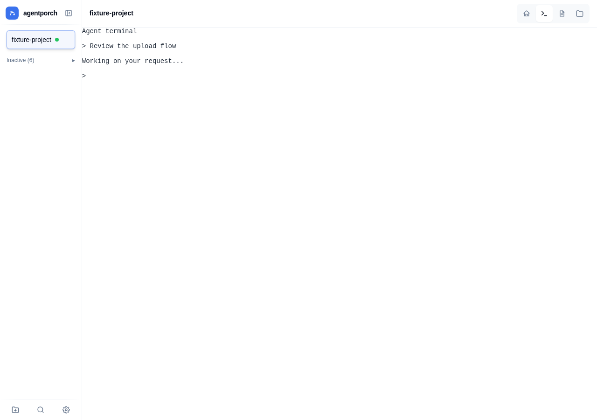
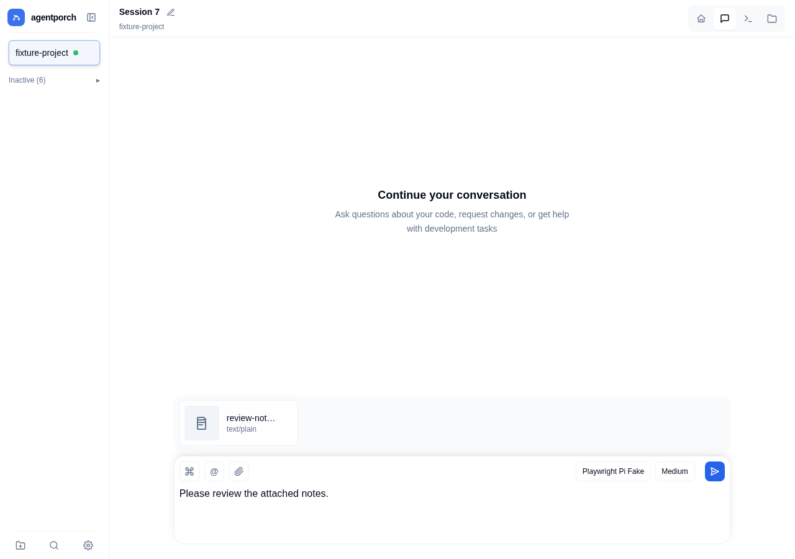
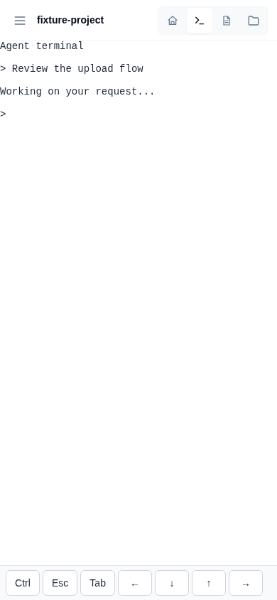
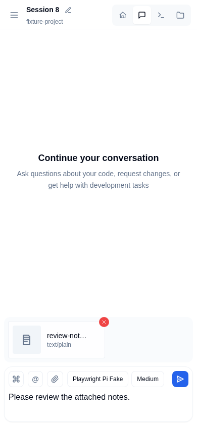
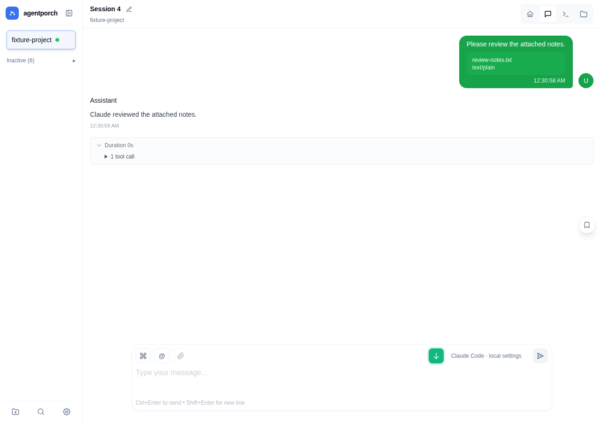
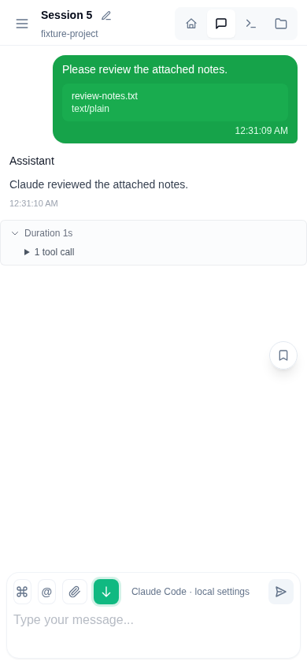

# Web chat and independent terminal

| Desktop before | Desktop after |
| --- | --- |
|  |  |

| Mobile before | Mobile after |
| --- | --- |
|  |  |

| Claude Code desktop | Claude Code mobile |
| --- | --- |
|  |  |

Actual local browser screenshots using synthetic projects and messages. The terminal output, Pi model, and Claude CLI are test fixtures; these images do not demonstrate a live model connection. No screenshot pixels were edited.

Conversations use Codex app-server, the Pi SDK, or Claude Code print/stream-json. The optional tmux project shell is independent of chat identity. Imported Hermes histories are read-only.
