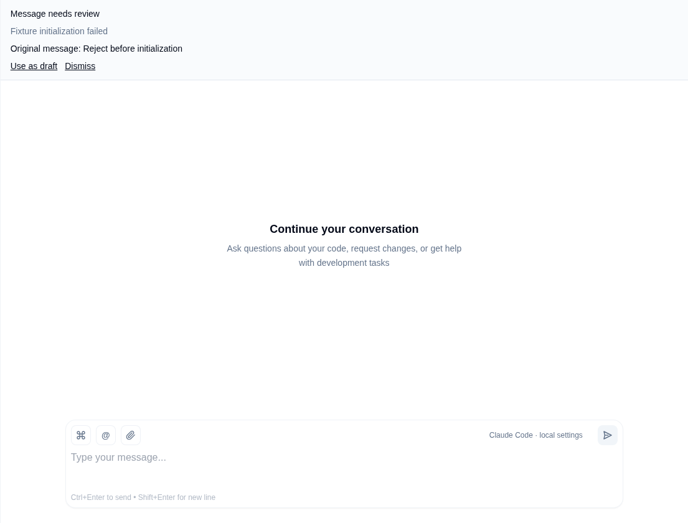
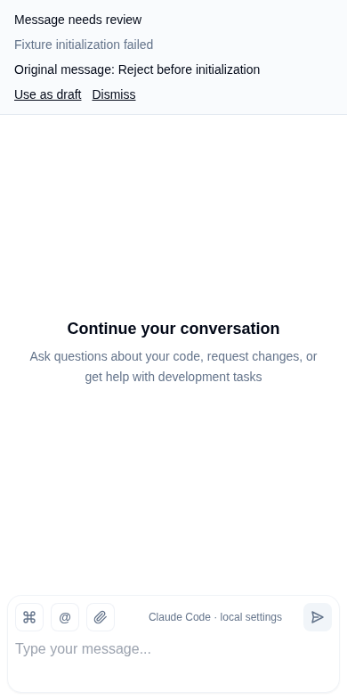
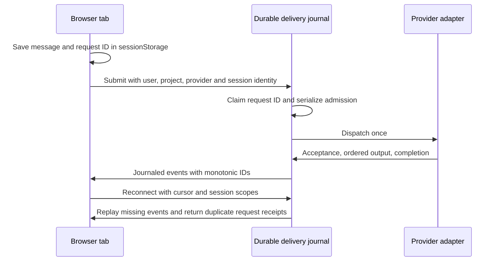

# Web chat delivery

| Recovery after refresh: desktop | Mobile |
| --- | --- |
|  |  |

Actual component screenshots from a simulated provider initialization failure. No pixel edits.

Codex uses the shared app-server's thread/turn RPCs. Pi uses SDK sessions and their preflight callback. Claude Code uses a print-mode process per turn and resumes the same native UUID. Claude acceptance now waits for its initialization event and a saved route binding; process creation alone is not acceptance. Admission is serialized by project/provider/session across browser connections. Provider-specific steering and busy rules still apply after admission.

The SQLite delivery journal records request fingerprints, original input, receipts, native bindings, and scoped output events. A retry with the same request ID returns its receipt instead of executing again; changing its content is rejected. Disconnecting the initiating socket does not remove the output's user identity. Subscriptions and browser rendering check project, provider and session, including colliding `c1` routes in different projects.

Unconfirmed sends remain in the tab's sessionStorage and retry with the original ID. In-page reconnects replay missing output in order and ignore duplicate event IDs. A full page reload hydrates provider history instead of replaying the old stream. Failed sends retain their original text for review after refresh; sending the same text explicitly creates a new request.

A server crash can occur between provider execution and its recorded acknowledgement. Such a request is **uncertain**, not safe to rerun: the UI asks the user to inspect history and keeps the original message. This is not an exactly-once guarantee for external tool side effects. Closing the browser tab or clearing its storage can remove sends that never reached the server. The local database retains delivery records alongside existing application state; backups and deletion policies should account for that data.

Tests inject duplicate sends, lost acknowledgements and a socket closure during output for all three providers. Separate tests reopen the SQLite database, exercise initialization failures, preserve failed input across refresh, and reject cross-user/project/provider replay. Browser tests use fixture providers, including real subprocess and app-server WebSocket framing; they do not call paid models. The Browser plugin was unavailable, so local Playwright was used.
